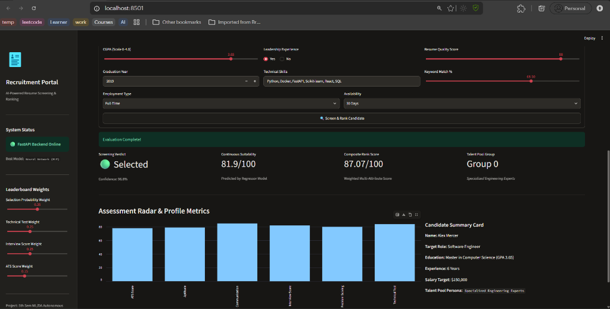
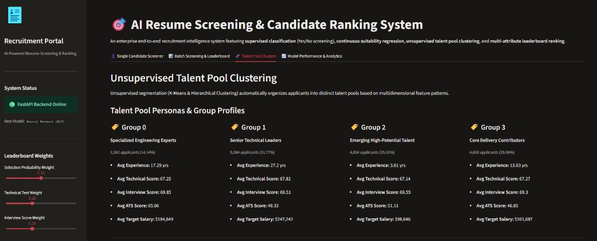
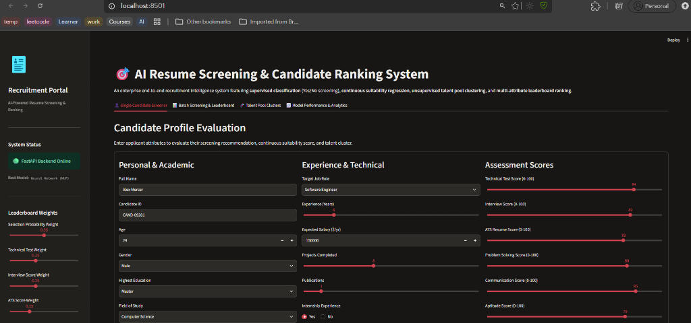
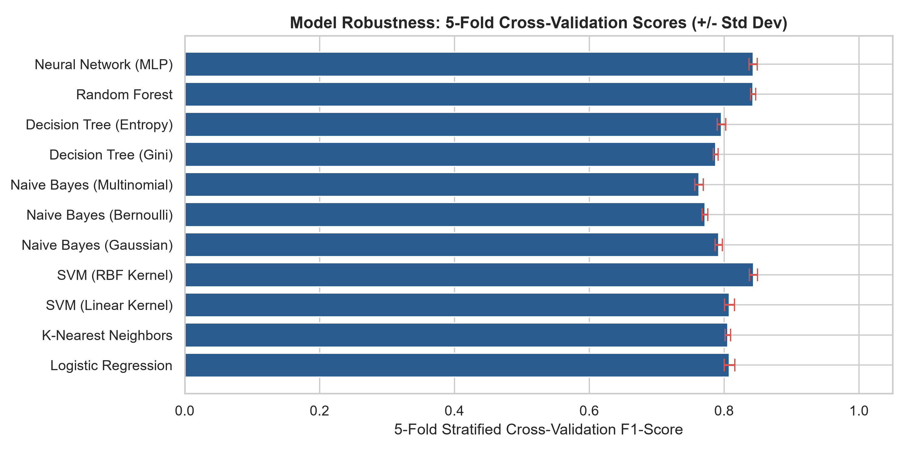

# AI Resume Screening & Candidate Ranking System

A full-stack machine learning project built to streamline technical hiring through automated resume screening, continuous suitability scoring, and talent pool segmentation.

The system combines supervised classification to predict selection decisions, regression modeling to score candidate suitability, unsupervised clustering to organize applicants into talent pools, and an interactive recruiter dashboard built with Streamlit and FastAPI.

---

## 📸 Application Screenshots

### 1. Recruiter Dashboard & Candidate Evaluation


### 2. Talent Pool Clustering & Personas


### 3. Dashboard Overview & Input Form


---

## 💡 What This Project Does

Recruiters often review thousands of applications with varying degrees of experience, education, and technical competencies. This system tackles the problem in four stages:

1. **Resume Screening (Classification):** Evaluates candidate attributes across 11 supervised learning algorithms to recommend whether an applicant should be screened in (`Selected` vs `Rejected`).
2. **Continuous Suitability Scoring (Regression):** For candidates passing initial screening, a regression model estimates a continuous suitability score ($0 - 100$) based on weighted domain performance.
3. **Multi-Criteria Ranked Leaderboard:** Combines model selection probabilities with core competency scores (technical assessment, interview, and ATS match) to produce a dynamic, sorted leaderboard.
4. **Talent Pool Segmentation (Clustering):** Groups candidates into 4 distinct talent personas (e.g., *Senior Technical Leaders*, *Emerging High-Potential Talent*) using K-Means and Hierarchical clustering.

---

## 📊 Model Evaluation & Analytics

Eleven classification models were trained and evaluated on an identical stratified test split ($4,000$ candidates) using 5-Fold Stratified Cross-Validation and 200 Bootstrapping iterations:

| Model Architecture | Test Accuracy | Test F1-Score | ROC-AUC | 5-Fold CV F1 ($\pm \sigma$) | 95% Bootstrapped F1 CI |
| :--- | :---: | :---: | :---: | :---: | :---: |
| **Neural Network (MLP)** 🏆 | **84.38%** | **84.69%** | **0.9274** | **$0.8432 \pm 0.0061$** | **$[0.8360, 0.8594]$** |
| **Random Forest** | 82.97% | 84.16% | 0.9177 | $0.8430 \pm 0.0038$ | $[0.8347, 0.8526]$ |
| **SVM (RBF Kernel)** | 83.13% | 83.66% | 0.9139 | $0.8435 \pm 0.0060$ | $[0.8252, 0.8476]$ |
| **Logistic Regression** | 81.43% | 81.36% | 0.8982 | $0.8079 \pm 0.0078$ | $[0.8023, 0.8248]$ |
| **SVM (Linear Kernel)** | 81.33% | 81.22% | 0.8982 | $0.8079 \pm 0.0075$ | $[0.7999, 0.8230]$ |
| **K-Nearest Neighbors (KNN)** | 80.85% | 81.26% | 0.8796 | $0.8057 \pm 0.0040$ | $[0.8033, 0.8250]$ |
| **Decision Tree (Gini)** | 79.37% | 79.67% | 0.8440 | $0.7877 \pm 0.0036$ | $[0.7838, 0.8108]$ |
| **Naive Bayes (Gaussian)** | 79.30% | 79.61% | 0.8657 | $0.7920 \pm 0.0054$ | $[0.7851, 0.8099]$ |
| **Decision Tree (Entropy)** | 78.08% | 78.58% | 0.8427 | $0.7959 \pm 0.0063$ | $[0.7727, 0.7997]$ |
| **Naive Bayes (Bernoulli)** | 77.52% | 77.71% | 0.8464 | $0.7717 \pm 0.0042$ | $[0.7659, 0.7904]$ |
| **Naive Bayes (Multinomial)**| 75.68% | 76.47% | 0.8238 | $0.7629 \pm 0.0063$ | $[0.7524, 0.7797]$ |

### Performance Visualizations

| 11-Model Benchmark Comparison | MLP Confusion Matrix |
| :---: | :---: |
|  |  |

| 5-Fold Stratified Cross-Validation | Talent Pool Clusters (2D PCA) |
| :---: | :---: |
|  |  |

---

## 🛠️ Tech Stack & Libraries

* **Machine Learning & Modeling:** `scikit-learn`, `numpy`, `pandas`, `scipy`, `joblib`
* **Data Visualization:** `matplotlib`, `seaborn`
* **Backend API:** `fastapi`, `uvicorn`, `pydantic`
* **Frontend Dashboard:** `streamlit`

---

## 📁 Repository Structure

```
Project/
├── ai_resume_screening_dataset.csv   # Source dataset (100k rows, 44 columns)
├── requirements.txt                  # Python dependencies
├── run_pipeline.py                   # Master script to train all models
├── run_backend.py                    # Starts FastAPI backend
├── start_app.bat                     # Windows one-click launcher
│
├── src/                              # ML Source Code
│   ├── preprocessing.py              # Data cleaning, encoding, and PCA
│   ├── classification.py             # 11 classification architectures
│   ├── ranking.py                    # Suitability regression & leaderboard
│   ├── clustering.py                 # K-Means, Hierarchical, talent pools
│   ├── validation.py                 # Cross-validation & bootstrapping
│   └── pipeline.py                   # Orchestration & plot generation
│
├── backend/                          # FastAPI Service
│   ├── main.py                       # REST API endpoints (/predict, /batch-predict, etc.)
│   └── schemas.py                    # Pydantic schemas
│
├── frontend/                         # Streamlit Dashboard
│   └── app.py                        # 4-tab interactive recruiter interface
│
├── models/                           # Saved Trained Models (.joblib)
│   ├── feature_pipeline.joblib       # Preprocessing & PCA pipeline
│   ├── best_classifier.joblib        # Optimal MLP classifier
│   ├── best_regressor.joblib         # Suitability regressor
│   ├── talent_clusterer.joblib       # K-Means talent pool model
│   └── pipeline_metadata.json        # Evaluation scores & metadata
│
├── artifacts/                        # Saved Plots & Visuals
│   ├── dashboard_preview.png         # Main dashboard screenshot
│   ├── screening_result.png          # Evaluation result screenshot
│   ├── talent_clusters.png           # Cluster personas screenshot
│   ├── model_comparison.png          # Model comparison bar chart
│   └── confusion_matrix_best.png     # Best model confusion matrix
│
└── tests/                            # Test Suite
    ├── test_endpoints_direct.py      # Direct backend unit tests
    └── test_batch_fix.py             # Batch inference verification
```

---

## 🚀 How to Run Locally

### 1. Set Up Environment
```powershell
# Clone the repository
git clone https://github.com/Csahoo009/ml-resume-screening-system.git
cd ml-resume-screening-system

# Create and activate virtual environment
python -m venv .venv
.venv\Scripts\Activate.ps1

# Install dependencies
pip install -r requirements.txt
```

### 2. Launch the Application
You can run the backend and dashboard together using the Windows launcher:
```powershell
.\start_app.bat
```

Or start them individually in separate terminals:

```powershell
# Terminal 1: Start FastAPI Backend (Port 8000)
python run_backend.py

# Terminal 2: Start Streamlit Dashboard (Port 8501)
streamlit run frontend/app.py
```

* The dashboard will open in your browser at `http://localhost:8501`.
* Interactive API documentation is available at `http://127.0.0.1:8000/docs`.

### 3. Re-train Models (Optional)
Pre-trained models are already included in `models/`. To re-run the complete training and validation pipeline from scratch:
```powershell
python run_pipeline.py
```
