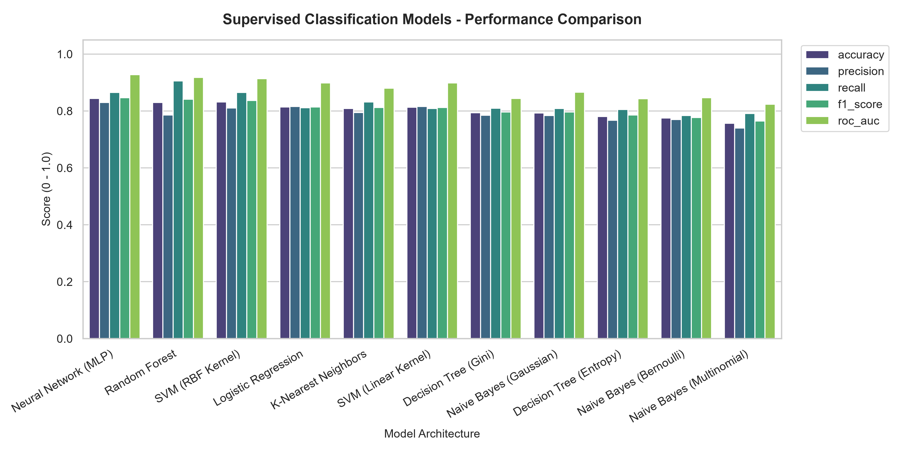
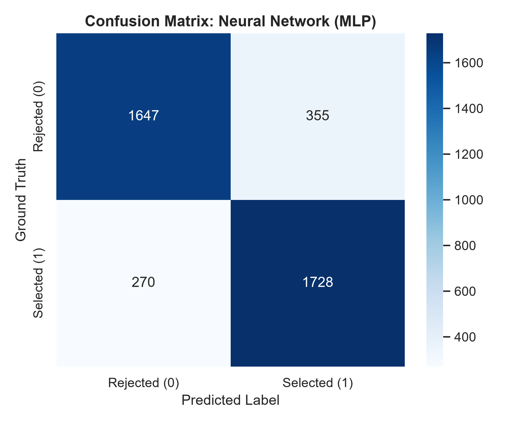
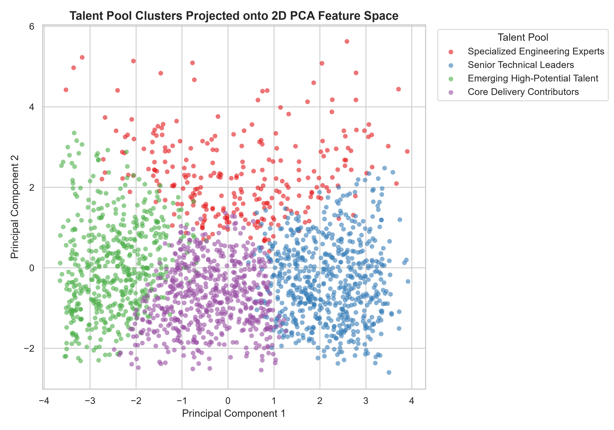

# Autonomous ML Resume Screening and Candidate Ranking System

An enterprise-grade, end-to-end Machine Learning pipeline and full-stack recruitment application developed for `ai_resume_screening_dataset.csv`.

---

## 🖥️ Interactive Recruiter Dashboard UI


---

## 🌟 Key Features

1. **Robust Data Preprocessing & Dimensionality Reduction**:
   - PII filtering (`candidate_id`, `full_name`, `email`, `phone`, `github_profile`, `linkedin_profile`).
   - Median imputation for numerical features and constant fill for categoricals.
   - Standard scaling and ordinal/one-hot encoding.
   - Domain feature engineering (`skills_count`, `has_certifications`, `has_previous_company`).
   - Principal Component Analysis (PCA): 15 principal components capturing 75.93% variance, plus 2D PCA projection.
   - **Strict featurization ordering**: Preprocessors fitted exclusively on training data after stratified train-test split.

2. **Supervised Classification Suite (11 Architectures)**:
   - Logistic Regression (Interpretable baseline)
   - K-Nearest Neighbors (KNN)
   - Support Vector Machines (Linear & RBF kernels)
   - Naive Bayes (Gaussian, Bernoulli, Multinomial)
   - Decision Trees (Gini Index & Entropy criteria)
   - Random Forest Classifier
   - Neural Network / ANN (Multi-Layer Perceptron)
   - **Best Classifier**: Neural Network (MLP) with **84.38% Accuracy**, **84.69% F1-Score**, and **0.9274 ROC-AUC**.

3. **Regression & Candidate Ranking**:
   - Continuous suitability modeling on selected candidates (`selected == 1`).
   - Multiple Linear Regression, Ridge Regression, and Random Forest Regressor.
   - Multi-attribute composite leaderboard combining selection probability, technical test score, interview score, and ATS score.

4. **Unsupervised Talent Pool Clustering**:
   - K-Means and Hierarchical Agglomerative Clustering.
   - Elbow method & silhouette score validation across $k \in [2, 7]$.
   - 4 Talent Pool Personas:
     - *Senior Technical Leaders* (Cluster 1: 31.77%)
     - *Core Delivery Contributors* (Cluster 3: 29.06%)
     - *Emerging High-Potential Talent* (Cluster 2: 25.02%)
     - *Specialized Engineering Experts* (Cluster 0: 14.14%)

5. **Rigorous Validation Protocol**:
   - 5-Fold Stratified Cross-Validation on all models.
   - 200 Bootstrapping resamples computing 95% Confidence Intervals.
   - Confusion matrix, precision, recall, F1, ROC-AUC, MSE, RMSE, and $R^2$.

6. **Integrated Full-Stack Application**:
   - **FastAPI Backend**: REST endpoints for single/batch prediction, metrics, clusters, and leaderboard.
   - **Streamlit Recruiter Dashboard**: Multi-tab UI featuring single candidate evaluator, batch CSV screening, talent cluster explorer, and model analytics.

---

## 📊 Model Evaluation & Analytics

| 11-Model Classification Benchmark | Best Model (MLP) Confusion Matrix |
| :---: | :---: |
|  |  |

| 5-Fold Stratified Cross-Validation | Talent Pool Clusters (2D PCA) |
| :---: | :---: |
|  |  |

---

## 📁 Repository Structure

```
Project/
├── ai_resume_screening_dataset.csv   # Dataset (100k rows, 44 columns)
├── requirements.txt                  # Python dependencies
├── run_pipeline.py                   # Master pipeline execution script
├── run_backend.py                    # FastAPI server entrypoint
├── start_app.bat                     # Windows one-click launcher
│
├── src/                              # Core ML Modules
│   ├── preprocessing.py              # Cleaning, imputation, scaling, PCA
│   ├── classification.py             # 11 classification models
│   ├── ranking.py                    # Suitability regression & leaderboard
│   ├── clustering.py                 # K-Means, Hierarchical, talent pools
│   ├── validation.py                 # 5-Fold CV & Bootstrapping CIs
│   └── pipeline.py                   # Master orchestration script
│
├── backend/                          # FastAPI REST API
│   ├── main.py                       # FastAPI application & endpoints
│   └── schemas.py                    # Pydantic request/response schemas
│
├── frontend/                         # Streamlit Dashboard
│   └── app.py                        # Interactive multi-tab recruiter UI
│
├── models/                           # Serialized Model Artifacts (.joblib)
│   ├── feature_pipeline.joblib       # Preprocessing & PCA pipeline
│   ├── best_classifier.joblib        # Optimal MLP classifier
│   ├── best_regressor.joblib         # Optimal linear regressor
│   ├── talent_clusterer.joblib       # K-Means talent clusterer
│   ├── all_classifiers.joblib        # All 11 trained classifiers
│   ├── all_regressors.joblib         # All trained regressors
│   └── pipeline_metadata.json        # Benchmark metrics & cluster profiles
│
├── artifacts/                        # Evaluation Charts & Sample Data
│   ├── model_comparison.png          # 11-model performance bar chart
│   ├── confusion_matrix_best.png     # MLP confusion matrix
│   ├── kfold_cv_comparison.png       # 5-fold CV error bar chart
│   ├── clustering_elbow_silhouette.png # Inertia and silhouette curves
│   ├── pca_talent_clusters.png       # 2D PCA cluster scatter plot
│   ├── regression_residuals.png      # Actual vs predicted & residuals
│   └── leaderboard_sample.csv        # Pre-scored leaderboard sample
│
└── tests/                            # Validation & Test Suite
    ├── test_endpoints_direct.py      # Direct backend endpoint unit tests
    └── test_frontend_load.py         # Frontend engine verification test
```

---

## 🚀 Quickstart Guide

### 1. Environment Setup
```powershell
# Activate the existing virtual environment:
.venv\Scripts\Activate.ps1
```

### 2. Run the Full ML Pipeline (Optional - Models Already Trained)
```powershell
.venv\Scripts\python run_pipeline.py
```

### 3. Launch the Backend API (FastAPI)
```powershell
.venv\Scripts\python run_backend.py
```
*API will run at `http://127.0.0.1:8000` with interactive Swagger docs at `http://127.0.0.1:8000/docs`.*

### 4. Launch the Recruiter Dashboard (Streamlit)
```powershell
.venv\Scripts\streamlit run frontend/app.py
```
*Dashboard will open at `http://localhost:8501`.*

### 5. One-Click Launcher (Windows)
Double-click `start_app.bat` to launch both backend and frontend simultaneously.
